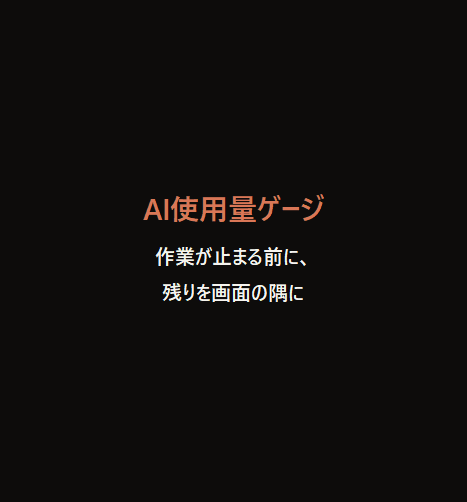

# AI使用量ゲージ

[English](README.md) · [한국어](README.ko.md) · **日本語** · [简体中文](README.zh.md)

Claude Codeで作業中に上限に達して手が止まる前に、残りを**推定**して画面の隅に常に表示する小さなWindowsツールです。

## ダウンロード（7日間無料体験）

**[⬇ AIUsageGauge.exe をダウンロード](../../releases/latest/download/AIUsageGauge.exe)** — Windows 11（Windows 10は動作確認中）、管理者権限は不要

体験後は買い切り 約$5（₩6,900）— **[ライセンスを購入](https://aivex.lemonsqueezy.com/checkout/buy/e78a9038-fcea-45ee-848a-5a87f3def1a9)**。サブスクではありません。

> まだコード署名がないため、初回起動時に「WindowsによってPCが保護されました」と表示される場合があります。**詳細情報 → 実行** を押してください。

## できること

- **色を見るだけ。** 5時間枠・直近7日の使用量を緑（余裕）・黄（注意）・赤（もうすぐ上限）で
- **実際の上限から学習。** 一度上限に達すると、その時の量から残りをより正確に推定し、今のペースでいつ使い切るかを表示
- **複数のAIをタブで。** Codex・Gemini CLI・Antigravityを使うと自動でタブが増えます
- **ムダな使用量を発見。** 長くなりすぎた会話を見つけ、新しい会話に引き継ぐ要約をコピー
- ダブルクリックで1行表示、ダーク/ライトテーマ、文字サイズ4段階、日本語・English・简体中文・한국어

## プライバシー

- PCに残るAIツールの記録だけを読みます（Claude Code: `~/.claude/projects`）
- ログイン情報やトークンは読みません。会話はPCの外に出ません（ネット接続はライセンス確認のみ）
- 残りは公式の数値ではなく**推定値**です

Anthropic・OpenAI・Googleとは無関係の、個人開発の非公式ツールです。ご意見・不具合は [Issues](../../issues) へどうぞ。
