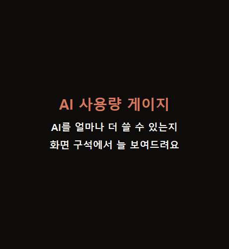

# AI 사용량 게이지

[English](README.md) · **한국어** · [日本語](README.ja.md) · [简体中文](README.zh.md)

Claude Code를 쓰다 작업 중간에 한도에 걸리기 전에, 남은 양을 **추정**해서 화면 구석에 늘 보여 주는 작은 Windows 프로그램입니다.

## 내려받기 (7일 무료 체험)

**[⬇ AIUsageGauge.exe 내려받기](../../releases/latest/download/AIUsageGauge.exe)** — Windows 11 (Windows 10은 확인 중), 관리자 권한 필요 없음

체험이 끝나면 한 번 구매 6,900원 — **[라이선스 사기](https://aivex.lemonsqueezy.com/checkout/buy/e78a9038-fcea-45ee-848a-5a87f3def1a9)**. 구독이 아닙니다.

> 아직 코드 서명이 없어 처음 실행할 때 "Windows의 PC 보호" 창이 뜰 수 있어요. **추가 정보 → 실행**을 누르세요.

## 할 수 있는 일

- **색만 보면 돼요.** 5시간·최근 7일 사용량을 초록(여유)·노랑(주의)·빨강(곧 다 씀)으로
- **실제 한도를 배워요.** 한 번 한도에 걸리면 그때까지 쓴 양으로 남은 양을 더 정확히 추정하고, 지금 속도면 언제 다 쓰는지 알려 줘요
- **여러 AI를 탭으로.** Codex·Gemini CLI·Antigravity를 쓰면 탭이 저절로 생겨요
- **새는 사용량을 찾아요.** 너무 길어진 대화를 찾고, 새 대화로 넘길 요약을 복사해 줘요
- 더블클릭으로 한 줄 보기, 어두운·밝은 테마, 글자 크기 4단계, 한국어·English·日本語·简体中文

## 개인정보

- PC에 남는 AI 도구 기록만 읽어요(Claude Code: `~/.claude/projects`)
- 로그인 정보·토큰은 읽지 않아요. 대화 내용은 PC 밖으로 나가지 않아요(인터넷은 라이선스 확인에만)
- 남은 양은 공식 수치가 아닌 **추정치**예요

Anthropic·OpenAI·Google과 무관한 개인 개발 비공식 도구입니다. 의견·오류 제보는 [Issues](../../issues)에 남겨 주세요.
