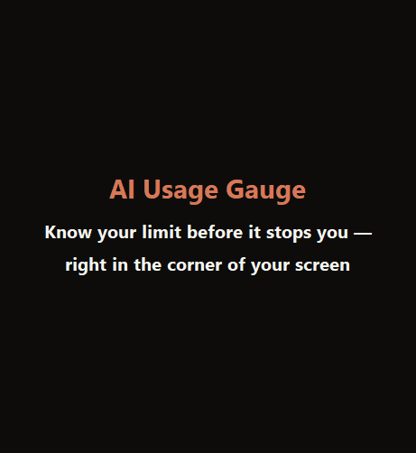
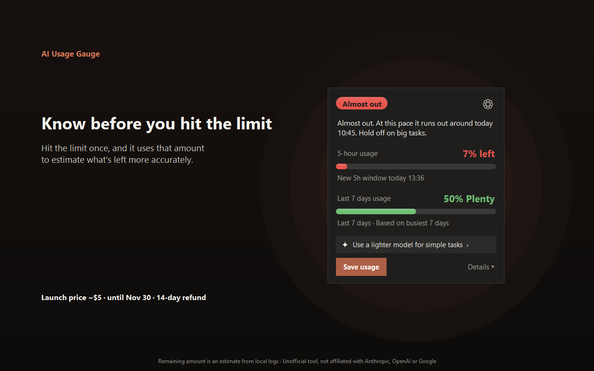
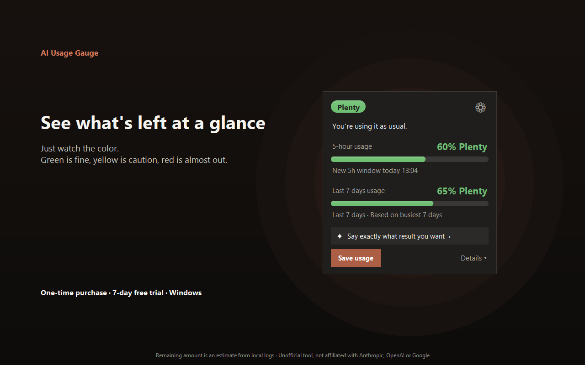
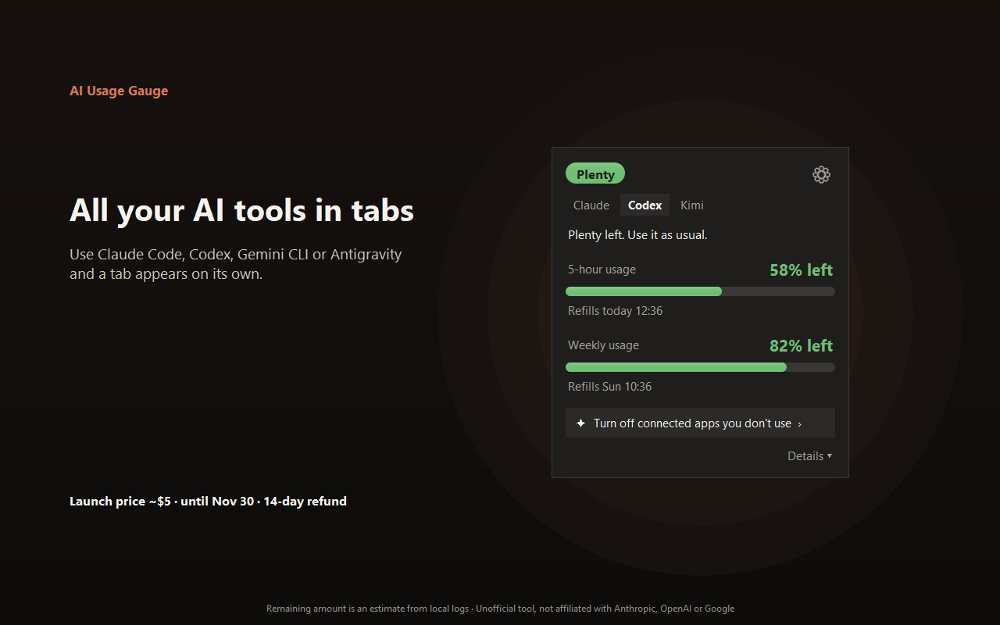
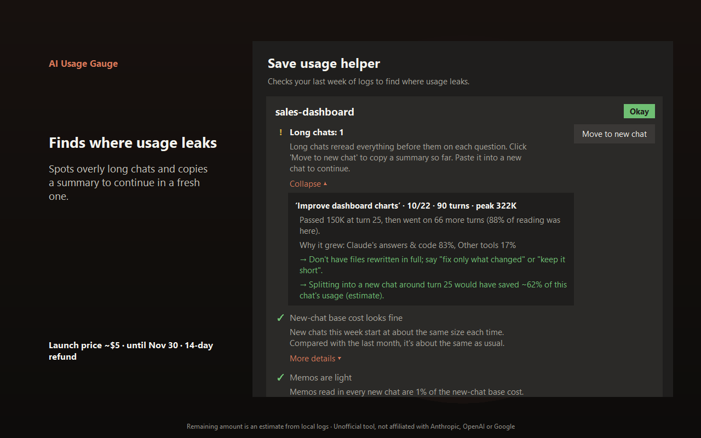

# AI Usage Gauge

**English** · [한국어](README.ko.md) · [日本語](README.ja.md) · [简体中文](README.zh.md)

**Know your Claude Code limit before it stops you — without typing `/usage`.**

A tiny always-on-top Windows widget that shows an **estimate** of how much of your Claude Code usage is left, right where you work.

Ever had Claude Code stop mid-task with "usage limit reached"? This keeps the answer in the corner of your screen.

## Download (free 7-day trial)

**[⬇ Download AIUsageGauge.exe](../../releases/latest/download/AIUsageGauge.exe)** — Windows 11 (Windows 10 not tested yet), no admin rights needed.

After the trial: **launch price about $5 (₩6,900) until Nov 30** (₩9,900 after), one-time — **[Buy a license](https://aivex.lemonsqueezy.com/checkout/buy/e78a9038-fcea-45ee-848a-5a87f3def1a9)**. No subscription. **14-day refund, no questions asked.**

> The installer isn't code-signed yet, so Windows SmartScreen may show "Windows protected your PC" on first run. Click **More info → Run anyway**.

## What it does

| | |
|---|---|
|  | **Know before you hit the limit.** Once you've hit a limit, it uses that amount to estimate what's left more accurately, and tells you when you'll run out at this pace. |
|  | **Just watch the color.** Green is fine, yellow is caution, red is almost out — for the 5-hour window and the last 7 days. |
|  | **All your AI tools in tabs.** Codex, Gemini CLI, Antigravity and Cursor (activity estimate) get their own tab if you use them. |
|  | **Finds where usage leaks.** Spots overly long chats and copies a summary so you can continue in a fresh one. |

**Add any AI that writes JSON logs** (pick its log folder) and set your own limit — in requests or tokens, refilling daily, every 5 hours, weekly or monthly. Many tabs? Scroll them sideways.

Also: double-click to shrink it to one line, dark/light theme, four text sizes, sharp on mixed-DPI monitors, and an English / 日本語 / 简体中文 / 한국어 UI that follows your Windows language.

## Privacy

- It reads only the logs AI coding tools already leave on your PC (Claude Code: `~/.claude/projects`).
- It never reads your login or tokens, and never calls private endpoints.
- Conversations never leave your PC. The internet is used only to check the license.
- The remaining amount is an **estimate**, not an official number.

## FAQ

**Claude Code already has `/usage`. Why this?** `/usage` is the official number — but you have to stop and type it, and it only tells you after you ask. The gauge stays on screen while Claude works, turns yellow when you're going faster than usual, and tells you roughly when you'll run out — so you find out *before* the limit, not at it. It also covers Codex, Gemini CLI, Antigravity and Cursor (activity estimate) in one place.

**Is this official?** No. It's an unofficial tool by an independent developer, not affiliated with Anthropic, OpenAI or Google.

**How accurate is it?** Until you hit a limit once, it compares you with your own busiest 5 hours / 7 days ("headroom"). After a limit hit, it uses that real amount.

**How many PCs?** One license works on up to 3 PCs.

**Uninstall?** Windows Settings → Apps → AI Usage Gauge → Uninstall.

---
This repository holds the download and documentation only. Feedback and bug reports are welcome in [Issues](../../issues).
