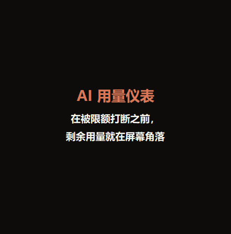

# AI 用量仪表

[English](README.md) · [한국어](README.ko.md) · [日本語](README.ja.md) · **简体中文**

**在被限额打断之前，剩余用量一直在屏幕角落——不用再敲 `/usage`。**

一个始终置顶的 Windows 小工具：把 Claude Code 剩余用量一直显示在你工作的屏幕上。1.2 起可直接显示 Claude Code 提供的**官方百分比**，不连接时则根据本机记录估算。

## 下载（7 天免费试用）

**[⬇ 下载 AIUsageGauge.exe](../../releases/latest/download/AIUsageGauge.exe)** — Windows 11（Windows 10 尚在测试），无需管理员权限

试用结束后一次买断，**首发价约 $5（₩6,900，11 月 30 日前，之后 ₩9,900）** — **[购买许可证](https://aivex.lemonsqueezy.com/checkout/buy/e78a9038-fcea-45ee-848a-5a87f3def1a9)**。不是订阅。**购买后 14 天内无理由全额退款。**

> 安装包暂时没有代码签名，首次运行可能出现「Windows 已保护你的电脑」，点 **更多信息 → 仍要运行** 即可。

## 功能

- **一键显示官方数值（1.2）。** 在终端使用 Claude Code 2.1.80 及以上且为 Pro/Max 订阅时，可连接 Claude Code 传给状态栏的官方剩余百分比。关闭后恢复原来的状态栏
- **看颜色就行。** 5 小时窗口和最近 7 天用量：绿色充足、黄色注意、红色快用完
- **从真实限额中学习。** 触顶一次后按当时用量更准确地估算剩余，并提示按当前速度何时用完
- **多个 AI 分标签。** 使用 Codex、Gemini CLI、Antigravity、Cursor（活动量估算） 会自动出现标签
- **找出浪费的用量。** 找出过长的对话，并复制摘要方便在新对话中继续
- 双击缩成一行、深色/浅色主题、4 档字号、简体中文·English·日本語·한국어

## 已经有 `/usage` 了，为什么还要它？

精确数值以官方 `/usage` 为准。但要查看就得停下手头的事自己输入，而且只有问了才告诉你。仪表在 Claude 工作时也一直显示，比平时用得快会变黄，并提示按当前速度大约何时用完——让你在**触顶之前**而不是触顶之后知道。Codex、Gemini CLI、Antigravity、Cursor（活动量估算） 也能一起看。

## 隐私

- 只读取本机 AI 工具留下的日志（Claude Code：`~/.claude/projects`）
- 不读取登录信息和令牌；对话内容不出本机（联网仅用于验证许可证）
- 未连接时剩余用量为**估算**；连接后使用 Claude Code 传给状态栏的数值（依然不读取登录信息）

与 Anthropic、OpenAI、Google 无关的个人开发非官方工具。欢迎在 [Issues](../../issues) 反馈。
